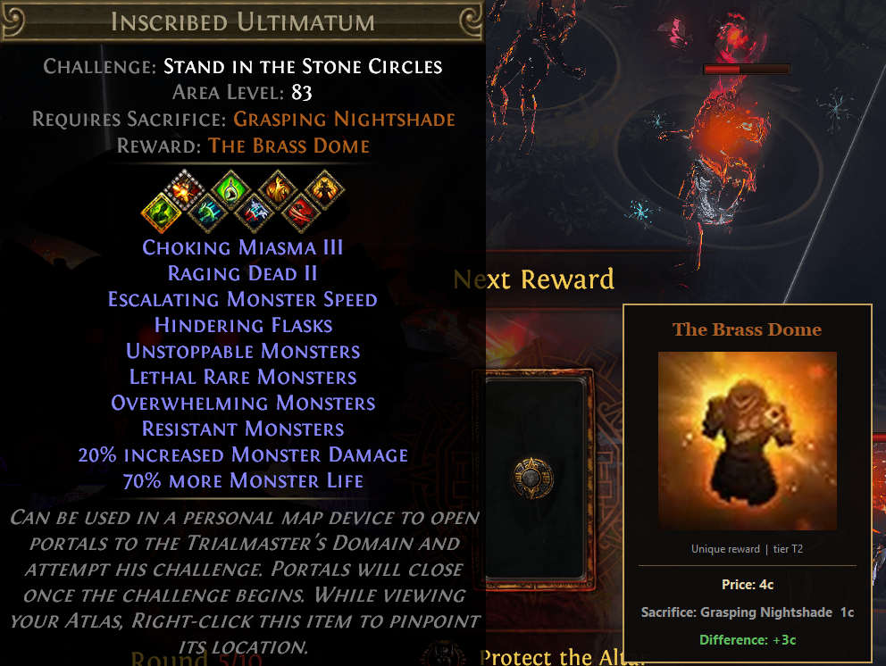

# Ultimatum Overlay for Path of Exile 1 (unofficial)

Hover an **Inscribed Ultimatum** in your inventory or stash and see what you would get, without leaving the game:

* **Divination card rewards:** the card's name, stack size and reward (for Ultimatums that double sacrificed divination cards).
* **Unique item rewards:** the unique item's picture and name, for example *The Magnate* or *The Immortal Will*.
* **Prices:** current prices from poe.ninja. For unique rewards it also compares the price of the sacrificed unique with the reward and shows the difference.

The tool takes a screenshot around your mouse cursor and reads the tooltip text with OCR. It does not touch the game.

> \*\*Disclaimer:\*\* This is an unofficial fan-made tool. It is not affiliated with, endorsed by or supported by Grinding Gear Games, poe.ninja, poedb.tw or Anthropic. \*Path of Exile\* is a trademark of Grinding Gear Games. The tool only reads pixels on your screen: it does not read or change game memory, does not inject into the game process and does not send inputs to the game. Grinding Gear Games has not officially approved tools of this kind, so use it at your own risk.

## Requirements

* Windows 10 or 11
* Path of Exile 1 in **windowed** or **borderless windowed** mode (an overlay cannot be drawn over exclusive fullscreen)
* Internet connection (for the first start and for price updates)

## Quick start (exe)

1. Download `UltimatumCardOverlay.exe` from the **Releases** page of this repository.
2. Put it in its own folder, for example `C:\\PoE-Overlay`. The tool creates the folders `card\_data` and `card\_images` next to itself.
3. Double-click it. A console window opens and stays open while the tool is running. Closing it quits the tool.
4. On the first start it downloads the card and unique item lists and the prices. Wait for the lines `\[ok] text recognition ready` and `\[ok] prices for league ...`.
5. Windows may show "Windows protected your PC" because the exe is not signed. Click **More info**, then **Run anyway**. Some antivirus programs warn about programs that read the screen and keyboard. If you do not trust the exe, build it yourself or run the Python script (see below).

## How to use

* Hover an Inscribed Ultimatum and keep the mouse still for about a second. The pop-up appears next to the tooltip.
* Move the mouse and the pop-up disappears.
* Press **F8** to force a scan. If nothing is found, the console prints the text it read, which helps with troubleshooting.

## Settings

Open `ultimatum\_card\_overlay.py` in a text editor and change the values at the top (the exe has no settings file, so use the Python script or rebuild the exe if you want to change them):

|Setting|Default|Meaning|
|-|-|-|
|`LEAGUE`|`"Covens"`|League name as on poe.ninja. `"auto"` uses the current challenge league.|
|`AUTO\_MODE`|`True`|`True`: scan automatically when the mouse rests. `False`: scan only with the hotkey.|
|`SCAN\_HOTKEY`|`"f8"`|Key that forces a scan.|
|`STILL\_SECONDS`|`0.6`|How long the mouse must rest before an automatic scan.|
|`PRICE\_REFRESH\_MINUTES`|`30`|How often prices are refreshed. poe.ninja itself updates about every 15 minutes.|
|`POPUP\_SHIFT\_CM`|`3`|Extra distance between the tooltip and the pop-up.|
|`MATCH\_CUTOFF`|`85`|How closely the OCR text must match a real name (0 to 100).|

## Your own card pictures (optional)

Put pictures into the folder `card\_images` and name them after the card or unique item, for example `The Fox in the Brambles.png`. They are shown instead of the built-in layout.

## Run from source

1. Install Python 3.10 to 3.12 (tick "Add Python to PATH").
2. `pip install -r requirements.txt`
3. `python ultimatum\_card\_overlay.py`

## Build the exe yourself (GitHub Actions)

1. Fork this repository (or upload the files to your own repository).
2. Open the **Actions** tab, choose **Build Windows exe** and click **Run workflow**.
3. When the run finishes, download `UltimatumCardOverlay` from the **Artifacts** section of the run and unzip it.

## Where the data comes from

|Data|Source|
|-|-|
|Prices|[poe.ninja](https://poe.ninja) economy API (cached, refreshed every 30 minutes)|
|Divination cards (names, stack sizes, rewards) and the list of Ultimatum uniques|[poedb.tw](https://poedb.tw)|
|Names of all unique items|Official Path of Exile trade site data|
|Item pictures|Downloaded from poedb.tw the first time an item is shown, then cached|

The tool does not ship any game assets. Everything is downloaded on first use and cached in the folder `card\_data`. Game images and texts belong to Grinding Gear Games. Please respect the terms of use of the sites above. The tool sends few requests and caches the results. If you change the code, please keep it that way so the community sites are not overloaded.

## Troubleshooting

* **Nothing appears:** Hover the item, press F8 and read the console output. Check the game runs in windowed or borderless mode and that the tooltip is fully visible.
* **"Price: not found":** Delete `prices.json` in the folder `card\_data` and restart the tool. Make sure `LEAGUE` matches the league name on poe.ninja.
* **No card data:** Check your internet connection and restart. Delete the `.json` files in `card\_data` to force a fresh download.
* **Text is misread:** OCR works best at the default UI scale. Please report the console output of an F8 scan together with your resolution.

## Third-party software

This project uses the following open source software. The names and licenses are listed to the best of my knowledge. Each project's own page has the full license text, which you must keep if you redistribute their code.

|Software|License|
|-|-|
|[Python](https://www.python.org) (including tkinter)|PSF License|
|[requests](https://github.com/psf/requests)|Apache-2.0|
|[keyboard](https://github.com/boppreh/keyboard)|MIT|
|[mss](https://github.com/BoboTiG/python-mss)|MIT|
|[Pillow](https://github.com/python-pillow/Pillow)|MIT-CMU (HPND)|
|[NumPy](https://github.com/numpy/numpy)|BSD-3-Clause|
|[RapidFuzz](https://github.com/rapidfuzz/RapidFuzz)|MIT|
|[Beautiful Soup 4](https://www.crummy.com/software/BeautifulSoup/)|MIT|
|[RapidOCR](https://github.com/RapidAI/RapidOCR) (rapidocr-onnxruntime, including its OCR models)|Apache-2.0|
|[ONNX Runtime](https://github.com/microsoft/onnxruntime)|MIT|
|[PyInstaller](https://github.com/pyinstaller/pyinstaller) (used to build the exe)|GPL-2.0 with a bootloader exception|

## Credits

Created by Muell0r together with Claude (Anthropic).

## License

See the file `LICENSE`.

